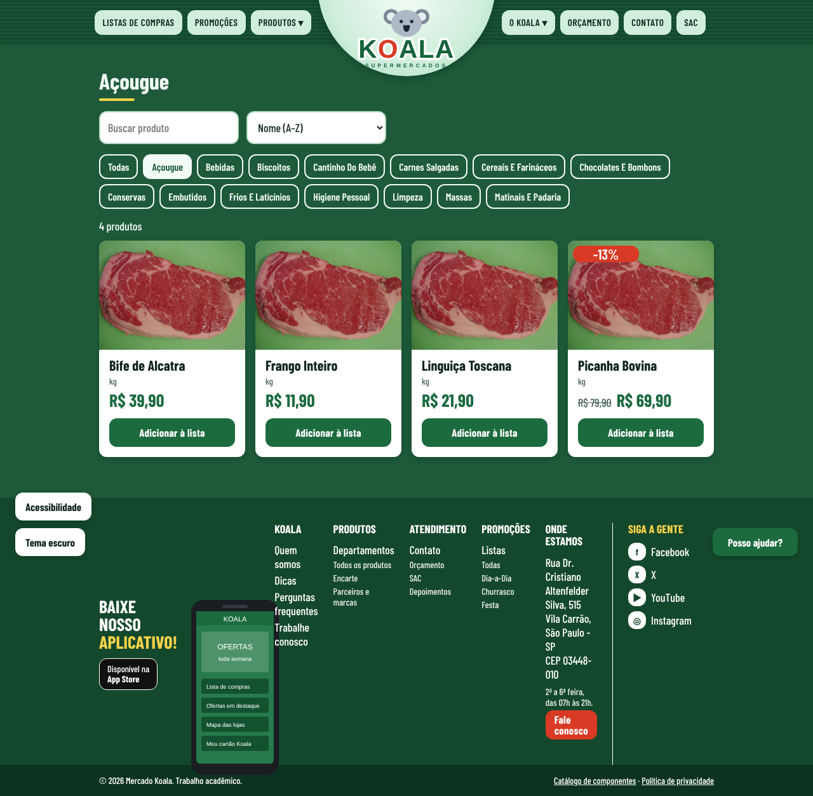
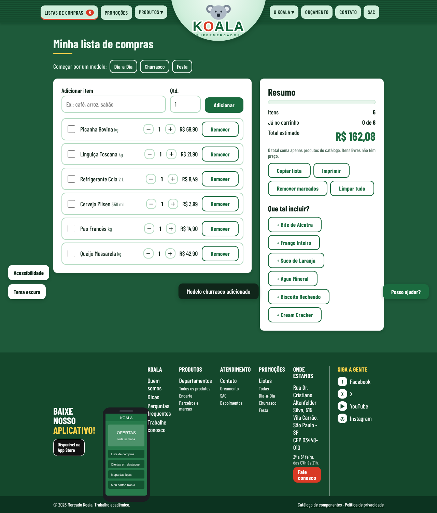
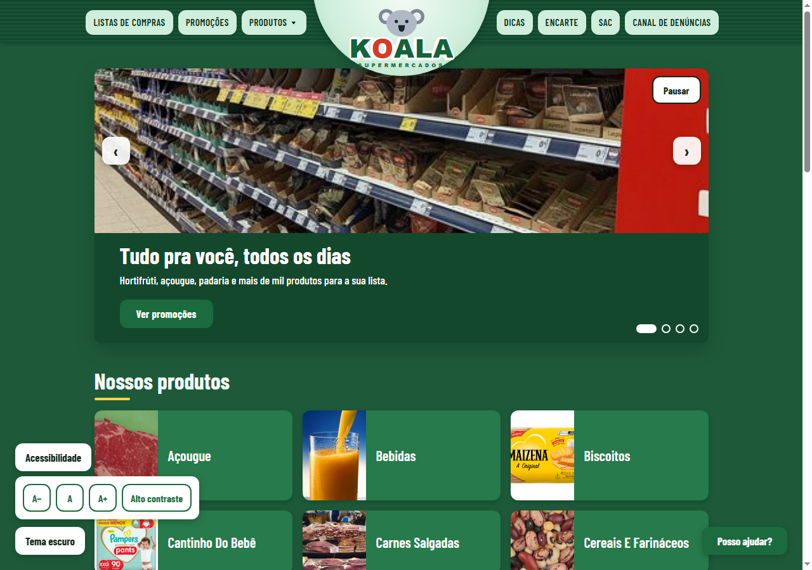
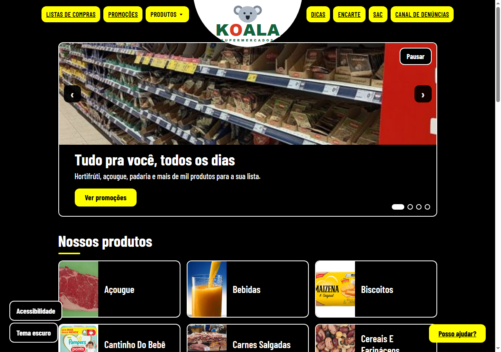

# 🐨 Koala Supermercados

Site de um supermercado fictício chamado **Koala**, feito só com **HTML, CSS e JavaScript puro**, sem frameworks e sem nenhuma biblioteca. Dá para navegar pelas categorias, ver as promoções, montar uma lista de compras que fica salva no navegador, falar com o SAC e usar tudo pelo teclado, com tema escuro e alto contraste.

🔗 **Site no ar:** https://koala-supermercados.vercel.app/


---

## 📚 Sumário

- [Sobre o projeto](#-sobre-o-projeto)
- [Integrantes do grupo](#-integrantes-do-grupo)
- [O que o site tem](#-o-que-o-site-tem)
- [Acessibilidade](#-acessibilidade)
- [Prints](#-prints)
- [Como iniciar o projeto](#-como-iniciar-o-projeto)
- [Como publicar na Vercel](#-como-publicar-na-vercel)
- [Estrutura de pastas](#-estrutura-de-pastas)
- [Como o visual foi pensado](#-como-o-visual-foi-pensado)
- [Tecnologias](#-tecnologias)
- [Fotos e créditos](#-fotos-e-créditos)
- [Critérios de aceite](#-critérios-de-aceite)

---

## 💡 Sobre o projeto

Este é um trabalho da disciplina de **Desenvolvimento Frontend para Web** (A2 · 2026.2), sob orientação do **Prof. Cid Andrade**.

A ideia foi criar uma loja virtual de supermercado com cara de site de verdade. Usamos como referência o layout do site do Supermercados Guanabara (a barra do topo, a grade de categorias, a lista de compras e o rodapé). **Só o layout**: a marca, o logo e as fotos são da Koala.

A cor principal é o **verde escuro**, que passa a ideia de frescor e confiança, e o site tem **tema claro, tema escuro e alto contraste**.

> Os produtos, os preços e o telefone 0800 do rodapé são inventados. O site não tem servidor: tudo o que você faz (lista, tema, preferências) fica salvo apenas no seu navegador.

---

## 👥 Integrantes do grupo

| Nome | RGM |
|------|----|
| Veronica dos Santos Lima | 48489841|
| Vitor Arruda Dos Santos | 47351241 |
| Victor Correa | 47093102 |
| Felipe de Oliveira Brito | 47639890 |

---

## 🛒 O que o site tem

| Página | O que dá para fazer |
|---|---|
| **Início** (`index.html`) | Carrossel de destaques, 14 categorias com foto, ofertas do dia com cronômetro, dicas e cadastro de e-mail para receber o encarte |
| **Produtos** (`produtos.html`) | Buscar por nome, filtrar por categoria, ordenar por nome ou preço e adicionar à lista |
| **Promoções** (`promocoes.html`) | O encarte da semana, com as ofertas ordenadas pelo maior desconto |
| **Lista de compras** (`lista.html`) | Adicionar itens, mudar a quantidade, marcar o que já pegou, ver o total estimado, copiar e imprimir. Tem modelos prontos: Dia-a-Dia, Churrasco e Festa |
| **SAC** (`sac.html`) | SAC e Canal de denúncias (com opção de envio anônimo), em abas e com validação dos campos |
| **Catálogo** (`catalogo.html`) | Todos os componentes (botão, campo, card, aviso, item de lista) em todos os estados |

Detalhes que fazem diferença:

- **Lista salva no navegador:** se você recarregar a página, ela continua lá. O contador no menu atualiza na hora.
- **Tema escuro** com um botão no canto da tela. O site lembra a sua escolha.
- **Responsivo:** no celular, as categorias viram uma coluna e o menu vira um botão "Menu".
- **Carrossel** com troca automática a cada 5 segundos, setas, bolinhas, teclado (← →) e arrastar com o dedo.

---

## ♿ Acessibilidade

A acessibilidade foi pensada com base nas recomendações da **WCAG 2.2 (nível AA)**. O que já está no site:

| Recurso | Como funciona |
|---|---|
| **Painel "Acessibilidade"** | Botão no canto inferior esquerdo. Tem **A−, A e A+** para o tamanho da letra e o botão **Alto contraste**. A escolha fica salva |
| **Alto contraste** | Tema em preto, branco e amarelo. Liga sozinho se o sistema do usuário pedir mais contraste |
| **Pular para o conteúdo** | Aperte `Tab` assim que a página abrir: aparece o link para ir direto ao conteúdo principal |
| **Foco visível** | Anel de foco em duas cores (escuro por dentro, amarelo por fora), que aparece tanto em fundo claro quanto escuro |
| **Teclado em tudo** | Menu, carrossel, abas do SAC, lista de compras e painel funcionam sem mouse. `Esc` fecha menus e painéis |
| **Carrossel pausável** | Botão "Pausar" e respeito ao `prefers-reduced-motion` (quem prefere menos movimento não vê a troca automática) |
| **Lista de compras** | Ao mexer em um item, o foco do teclado continua no mesmo botão. As ações são anunciadas ("Arroz removido da lista") |
| **Leitor de tela** | Botões com o nome do produto ("Adicionar à lista: Arroz"), preço antigo lido como "De … por …", desconto falado, avisos e erros anunciados |
| **Formulários** | Cada erro aparece junto do campo, ligado a ele com `aria-describedby`, e o foco vai para o primeiro erro |
| **Alvos de toque** | Botões com pelo menos 44 px de altura |

Com a letra no tamanho máximo (150%), o menu de computador pode ficar apertado, mas no celular o menu "hambúrguer" resolve.

Testamos no Chrome (computador). Ainda vale uma conferida com leitor de tela (NVDA ou TalkBack) e com uma ferramenta como o Lighthouse ou o axe.

---

## 📸 Prints

### Página inicial
As 14 categorias com foto real, as ofertas do dia com cronômetro, as dicas, a faixa da loja e o rodapé "Baixe nosso aplicativo".


### Produtos de uma categoria
Busca, filtro por categoria, ordenação e botão "Adicionar à lista".



### Lista de compras
No print foi usado o modelo Churrasco.



### Painel de acessibilidade
Tamanho da letra e alto contraste, no canto inferior esquerdo.



### Alto contraste
Preto, branco e amarelo, com bordas bem marcadas. O print está com a letra um pouco maior.



### Tema escuro


### Catálogo de componentes
Todos os componentes em todos os estados: normal, hover, foco, desabilitado e erro.


### No celular (360 px)


---

## 🚀 Como iniciar o projeto

Não precisa instalar nada: não tem `npm`, build ou dependências.

### 1. Baixar o projeto

```bash
git clone https://github.com/veronisky/Koala-mercado-Javascript.git
cd Koala-mercado-Javascript/loja-koala
```

Ou baixe o ZIP pelo botão **Code → Download ZIP** no GitHub e extraia.

### 2. Abrir o site

**Jeito mais simples:** dê dois cliques no arquivo `loja-koala/index.html`. Ele abre no navegador.

**Jeito recomendado (servidor local):** alguns recursos funcionam melhor com um servidor, como o `localStorage` em alguns navegadores. Dentro da pasta `loja-koala`, use uma das opções:

```bash
# Python (já vem instalado na maioria dos computadores)
python -m http.server 8000

# ou Node.js
npx serve .
```

Depois abra **http://localhost:8000** no navegador.

**No VS Code:** instale a extensão **Live Server**, clique com o botão direito em `loja-koala/index.html` e escolha **Open with Live Server**.

### 3. Conferir se está tudo certo

- Aperte `Tab` na página inicial: deve aparecer o link "Pular para o conteúdo".
- Clique em **Acessibilidade** (canto inferior esquerdo) e teste o **Alto contraste**.
- Adicione um produto à lista e recarregue a página: o item deve continuar lá.

> **Observação:** a pasta `loja-koala/` é o site completo. Os arquivos que ficam fora dela (`index.html`, `paginas/`, `css/`, `js/`, `assets/`) são de uma versão anterior do trabalho, o *Mercado Koala* azul, e não fazem parte do site publicado.

---

## ☁️ Como publicar na Vercel

O site é estático, então a publicação é simples:

1. Entre em [vercel.com](https://vercel.com) e clique em **Add New → Project**.
2. Importe o repositório `Koala-mercado-Javascript` do GitHub.
3. Em **Root Directory**, escolha **`loja-koala`**.
4. Deixe **Framework Preset** como *Other* e não preencha comando de build.
5. Clique em **Deploy**.

Depois disso, cada `git push` na branch `main` atualiza o site sozinho.

---

## 🗂️ Estrutura de pastas

```
loja-koala/
├── index.html          # página inicial
├── produtos.html       # produtos, com busca e filtros
├── promocoes.html      # encarte
├── lista.html          # lista de compras
├── sac.html            # SAC e canal de denúncias
├── catalogo.html       # todos os componentes em todos os estados
├── tokens.css          # fonte única de cores, espaços, raios e fontes
├── AGENTS.md           # regras do projeto para a IA seguir
├── css/
│   └── estilos.css     # estilo dos componentes e do layout
├── js/
│   ├── data.js         # categorias, produtos, dicas e modelos de lista
│   └── app.js          # tema, acessibilidade, lista, cabeçalho e rodapé
├── img/
│   ├── logo.svg        # logo da Koala
│   ├── app.svg         # celular do rodapé
│   └── fotos/          # fotos reais + CREDITOS.md
└── docs/prints/        # imagens usadas neste README
```

---

## 🎨 Como o visual foi pensado

O professor passou um fluxo em quatro passos: **referência antes, design system como contexto, prompt com critério de aceite e teste depois.**

1. **Referência antes:** olhamos o site do Guanabara e aproveitamos só o jeito de organizar a página.
2. **Design system como contexto:** o `tokens.css` é o único arquivo com cores. Todo o resto usa `var(--cor-...)`. O `AGENTS.md` guarda as regras para a IA seguir.
3. **Critério de aceite:** a lista está mais abaixo.
4. **Teste depois:** o `catalogo.html` reúne todos os componentes num lugar só, em vez de testar página por página.

### Mudar a geometria, não só a cor
Para o site não ficar com cara de template, mudamos também a forma das coisas:

- **Raio:** 12 px nas bordas de botões, cards, campos e carrossel (`--raio`).
- **Espaço:** escala de 4 px (4, 8, 12, 16, 24, 40, 64).
- **Letras:** escala tipográfica de 1.25, com a fonte *Barlow Condensed*.

### Regras do `AGENTS.md`

- HTML semântico, com um único `<h1>` por página.
- Cores, espaços e raios só com `var(--...)` do `tokens.css`.
- Nunca usar cor hexadecimal fora do `tokens.css`.
- Reusar `.botao`, `.card` e `.campo`, sem criar variações.
- Sem bibliotecas novas.
- Testar em 360 px, 768 px e 1280 px.

Como as cores ficam todas no `tokens.css`, os três temas (claro, escuro e alto contraste) são só três conjuntos de variáveis. Para criar um tema novo, basta acrescentar um bloco `[data-...]` nesse arquivo.

---

## 🧰 Tecnologias

- **HTML5** semântico
- **CSS3**: variáveis CSS, Grid, Flexbox e media queries (incluindo `prefers-reduced-motion`, `prefers-color-scheme` e `prefers-contrast`)
- **JavaScript puro**, sem frameworks
- **localStorage** para guardar a lista de compras, o tema e as preferências de acessibilidade
- **Vercel** para publicar o site

---

## 📷 Fotos e créditos

As fotos são reais e vieram do **Wikimedia Commons**. Cada foto tem a sua licença, e a lista com título, autor e licença está em [loja-koala/img/fotos/CREDITOS.md](loja-koala/img/fotos/CREDITOS.md).

Cada categoria tem uma foto, e os produtos da mesma categoria usam a mesma foto.

---

## ✅ Critérios de aceite

- [x] A página inicial mostra as 14 categorias com foto, e cada uma leva ao filtro certo.
- [x] Adicionar um produto atualiza o contador da lista sem recarregar a página.
- [x] A lista continua salva depois de recarregar e calcula o total.
- [x] Os formulários mostram o erro de cada campo e levam o foco para o primeiro erro.
- [x] Dá para usar tudo pelo teclado, com foco visível.
- [x] Existe tema escuro e alto contraste, e o site lembra a escolha.
- [x] Não há cor hexadecimal fora do `tokens.css`.
- [x] O layout funciona em 360 px e 1280 px.
- [ ] Conferir o layout em 768 px.

---

*Projeto acadêmico da disciplina de Desenvolvimento Frontend para Web (Prof. Cid Andrade), 2026.*
