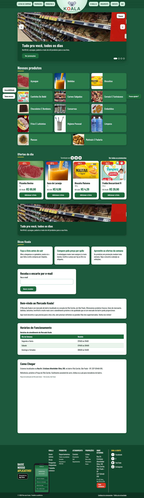
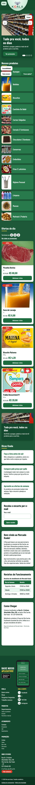
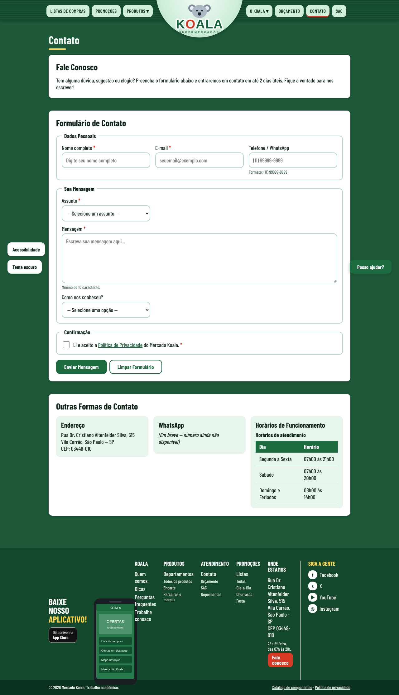
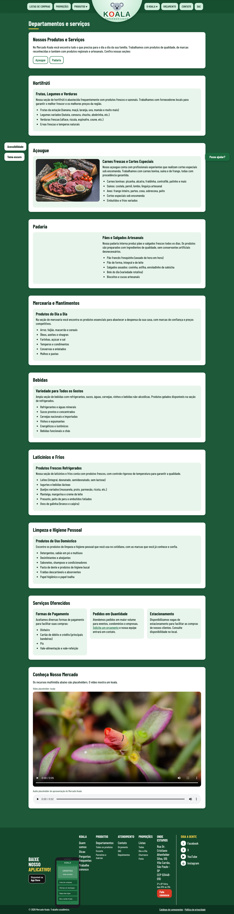
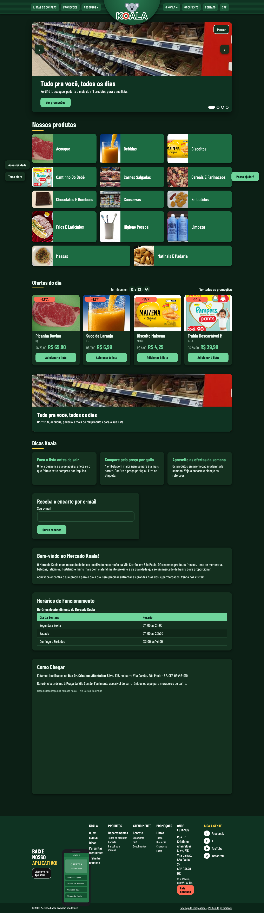
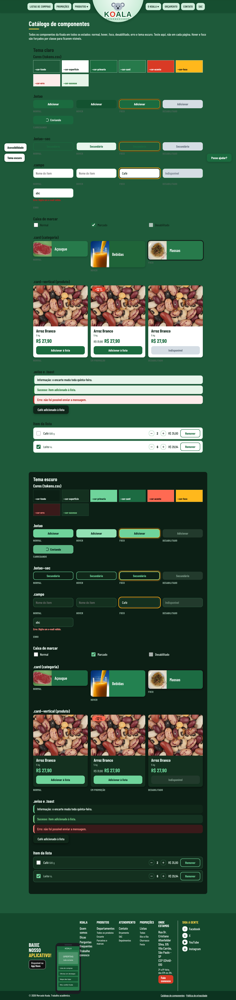

# Mercado Koala — Site de Divulgação

Site do **Mercado Koala**, mercado de bairro da Vila Carrão (São Paulo), feito com HTML, CSS e JavaScript puro, sem bibliotecas.
Projeto da disciplina de **Desenvolvimento Frontend para Web** (A2 · 2026.2), Prof. Cid Andrade. Este README atende ao item 6 do enunciado da **Entrega 2**.

**Site hospedado:** https://veronisky.github.io/Koala-mercado-Javascript/ (GitHub Pages, publicado a cada atualização da branch `main`)

---

## 👥 Integrantes do grupo

| Nome | RGM |
|------|----|
| Veronica dos Santos Lima | 48489841 |
| Vitor Arruda Dos Santos | 47351241 |
| Victor Correa | 47093102 |
| Felipe de Oliveira Brito | 47639890 |

---

## 🏪 Introdução — a organização

O **Mercado Koala** é um mercado de bairro localizado na:

> **Rua Dr. Cristiano Altenfelder Silva, 515 — Vila Carrão, São Paulo - SP, CEP 03448-010**

É um negócio familiar, criado para oferecer aos moradores da Vila Carrão produtos frescos, atendimento próximo e preços justos. Tem seções de hortifrúti, açougue, padaria artesanal, mercearia, bebidas, laticínios e produtos de limpeza e higiene.

**Objetivo do site:** divulgar o mercado na internet, com a história da empresa, os departamentos e produtos, as ofertas, uma lista de compras, os canais de contato e os formulários de contato, orçamento e currículo.

---

## 🗂️ Estrutura do projeto

Segue a organização sugerida no enunciado (página inicial na raiz, páginas de conteúdo em `paginas/`, e pastas `css/`, `js/` e `assets/`).

```
Koala-mercado-Javascript/
├── index.html                  # Página inicial
├── paginas/
│   ├── contato.html            # Contato (formulário com validação nativa do HTML5)
│   ├── orcamento.html          # Orçamento / solicitação
│   ├── sobre.html              # Quem somos (foto da entrevista)
│   ├── departamentos.html      # Departamentos e serviços (vídeo e áudio)
│   ├── produtos.html           # Produtos com busca, filtro e ordenação
│   ├── promocoes.html          # Encarte de promoções
│   ├── lista.html              # Lista de compras
│   ├── faq.html                # Perguntas frequentes
│   ├── depoimentos.html        # Depoimentos de clientes
│   ├── trabalhe-conosco.html   # Trabalhe conosco (cadastro de currículo)
│   ├── parceiros.html          # Parceiros e marcas
│   ├── politica.html           # Política de privacidade
│   ├── sac.html                # SAC e canal de denúncias
│   └── catalogo.html           # Catálogo de componentes (teste visual)
├── css/
│   ├── tokens.css              # Fonte única de cores, espaços, raios e tipografia
│   └── estilos.css             # Componentes e layout (Grid e Flexbox)
├── js/
│   ├── data.js                 # Categorias, produtos, dicas e modelos de lista
│   ├── app.js                  # Tema, lista de compras, menus, acessibilidade
│   └── formularios.js          # Máscaras e confirmação dos formulários
├── assets/
│   ├── img/                    # logo.svg, app.svg, fotos/ e foto da entrevista
│   ├── audio/                  # Áudio de apresentação
│   ├── video/                  # Vídeo de apresentação
│   └── prints/                 # Capturas usadas neste README
├── AGENTS.md                   # Regras do projeto usadas como contexto para a IA
└── README.md
```

São **15 páginas HTML** interligadas pelo mesmo menu (cabeçalho) e pelo mesmo mapa do site (rodapé).

### Como os requisitos técnicos foram atendidos

| Requisito do enunciado | Onde está |
|---|---|
| 10 páginas interligadas, com `index`, `contato` e `orcamento` | 15 páginas; menu igual no `<header>` e mapa do site no `<footer>` de todas |
| `header`, `nav`, `main`, `section`, `article`, `footer` | Em todas as páginas. O cabeçalho e o rodapé estão escritos no HTML (antes eram gerados por JavaScript) |
| Formulário de contato com validação nativa do HTML5 | `paginas/contato.html`: `required`, `type="email"`, `type="tel"`, `pattern`, `minlength`, `maxlength`. O navegador bloqueia o envio sem depender de JS |
| Máscaras | `js/formularios.js` formata telefone `(11) 99999-9999` e CNPJ `00.000.000/0000-00` enquanto a pessoa digita. O formato é conferido pelo `pattern` do HTML |
| `<audio>` e `<video>` | `paginas/departamentos.html`, seção "Conheça Nosso Mercado" |
| SVG em uma imagem | `assets/img/logo.svg` (logo no cabeçalho) e `assets/img/app.svg` (celular no rodapé) |
| CSS com identidade única, Grid e Flexbox | `css/tokens.css` + `css/estilos.css`. Grid nas grades de categorias, produtos, dicas, rodapé, seções e formulários; Flexbox no corpo, cabeçalho, filtros e botões |
| JavaScript respondendo a eventos | Carrossel, menus, lista de compras, busca e filtros, tema escuro, painel de acessibilidade, abas do SAC, máscaras |
| Validação W3C | Ver [Validação](#-validação-w3c) |

---

## 🛠️ Desenvolvimento

### Entrevista com a organização

O Mercado Koala é o negócio do pai de Marcelo Gabriel Alves, o que garantiu acesso direto ao responsável para levantar informações reais sobre endereço, funcionamento, serviços, produtos e diferenciais do estabelecimento.

A entrevista foi feita de forma presencial.

> 📷 **Foto que comprova o contato com o responsável:** [`assets/img/entrevista-responsavel.jpg`](assets/img/entrevista-responsavel.jpg), também exibida na página [Quem somos](paginas/sobre.html).


### Processo de desenvolvimento

**Entrega 1 — estrutura.** As páginas foram escritas primeiro só com HTML semântico, com o conteúdo levantado na entrevista: história, missão, departamentos, horários, formas de pagamento, FAQ e política de privacidade.

**Pesquisa de leiaute.** Usamos como referência o site do Supermercados Guanabara, copiando **só a organização** da página: barra no topo com a logo no centro, grade de categorias com foto, lista de compras e rodapé em colunas. A marca, o logo e as fotos não são do Guanabara.

**Testes de paleta e tipografia.**
1. A primeira versão usava **azul claro com cinza claro** (cores do koala), com Bootstrap só no menu.
2. Na loja nova a cor principal passou para **verde escuro**, que lembra mercado, frescor e confiança. A troca foi feita só em `css/tokens.css`, nos temas claro e escuro, e nos SVGs do logo e do app.
3. Preços ficam em verde, ofertas em vermelho e o foco do teclado em amarelo, para manter o contraste.
4. Tipografia: **Barlow Condensed** (Google Fonts), em escala de 1.25.
5. Geometria: bordas de 12 px (`--raio`) e espaços em escala de 4 px.

**Design system.** Todas as cores, espaços e raios estão em `css/tokens.css`. Nenhum outro arquivo tem cor hexadecimal. A página `paginas/catalogo.html` mostra cada componente (botão, campo, card, aviso, item da lista) em todos os estados.

**Reorganização da Entrega 2.** O repositório tinha dois sites: o institucional, na raiz, e a loja, em `loja-koala/`. Eles foram unidos em um só, na estrutura do enunciado:
- a loja passou a ser a página inicial, e suas páginas foram para `paginas/`;
- as páginas institucionais (Quem somos, Departamentos, Contato, Orçamento, FAQ, Depoimentos, Trabalhe conosco, Parceiros, Política) ganharam o visual da loja **sem mudança de conteúdo**. Só saiu uma frase desatualizada que dizia que o vídeo e o áudio seriam "reposicionados quando definirmos o CSS";
- horários, mapa e boas-vindas da antiga página inicial foram para a nova página inicial;
- o cabeçalho, o menu e o rodapé deixaram de ser gerados por JavaScript e passaram a estar no HTML de cada página;
- as perguntas do FAQ viraram `<details>`/`<summary>`, que abrem e fecham sem JavaScript.

**Desafios técnicos.**
- **Caminhos relativos:** as fotos dos produtos são montadas pelo JavaScript e precisam funcionar tanto em `index.html` quanto em `paginas/`. O `data.js` calcula o endereço a partir da própria localização (`new URL("../assets/img/fotos/", document.currentScript.src)`).
- **Validação nativa x máscara:** a máscara só formata o texto. Quem decide se o campo é válido é o `pattern` do HTML.
- **CNPJ condicional:** o campo só fica obrigatório quando o tipo de cliente é "Pessoa jurídica".
- **Acessibilidade:** link "Pular para o conteúdo", `aria-current` no menu, foco visível em duas cores, tema escuro, alto contraste e ajuste do tamanho da letra.

### Prints

| Página inicial | Celular (360 px) |
|---|---|
|  |  |

| Produtos do açougue | Lista de compras |
|---|---|
|  |  |

| Contato (validação nativa) | Departamentos (vídeo e áudio) |
|---|---|
|  |  |

| Tema escuro | Catálogo de componentes |
|---|---|
|  |  |

### Como seria o mesmo resultado feito com IA

O professor passou um fluxo em quatro passos, que é o que usaríamos para obter um resultado equivalente com IA:

1. **Referência antes:** escolher o site de referência (Guanabara) e descrever para a IA só o leiaute que deve ser seguido.
2. **Design system como contexto:** entregar `css/tokens.css` e `AGENTS.md` junto com o pedido, para a IA usar só as variáveis e os componentes existentes.
3. **Prompt com critério de aceite:** pedir cada página com uma lista do que precisa funcionar (exemplo: "o formulário bloqueia o envio sem e-mail válido usando só HTML").
4. **Teste depois:** conferir no navegador em 360, 768 e 1280 px, no `catalogo.html` e no validador W3C.

A IA gera a estrutura bem mais rápido. Mas o conteúdo real (endereço, horários, serviços) só existe porque fizemos a entrevista, e qualquer resposta da IA precisa ser conferida, porque ela inventa dados e caminhos de arquivos com facilidade.

### Uso de IA

- **Claude Code (Anthropic):** usado para reorganizar o repositório na estrutura do enunciado, deixar o cabeçalho e o rodapé fixos no HTML, adaptar as páginas institucionais ao visual da loja, rodar o validador W3C localmente e gerar os prints. **Verificação:** todos os links foram conferidos por script, as páginas foram abertas no navegador em 1280 e 360 px e os formulários foram testados (envio bloqueado com campos inválidos, máscaras e confirmação).
- **[COMPLETAR pelo grupo]:** quais outras ferramentas e modelos de IA foram usados nas Entregas 1 e 2, para quê, por que e como as respostas foram conferidas.

---

## ✅ Validação W3C

Todas as páginas e os arquivos CSS foram verificados com o **Nu Html Checker** (`vnu.jar`, o mesmo motor do https://validator.w3.org/) e passaram **sem erros e sem avisos**:

```
java -jar vnu.jar index.html paginas/*.html   # 0 mensagens
java -jar vnu.jar --css css/*.css             # 0 mensagens
```

**[COMPLETAR pelo grupo]:** colocar aqui os prints da validação online, em https://validator.w3.org/ (por endereço do site publicado) e em https://jigsaw.w3.org/css-validator/, que é o que o enunciado pede como comprovação.

---

## 🌐 Domínio

O Mercado Koala ainda não tem domínio próprio. O domínio escolhido é **`mercadokoala.com.br`**: `.com.br` é o padrão para comércio no Brasil e passa mais confiança para clientes locais.

**Pesquisa de disponibilidade:** consulta ao RDAP oficial do Registro.br (`https://rdap.registro.br/domain/mercadokoala.com.br`) em 06/11/2026 retornou **404 (domínio não registrado)**, ou seja, disponível. Para comparar, a mesma consulta para `registro.br`, que existe, retornou 200.
**[COMPLETAR pelo grupo]:** adicionar o print da busca em https://registro.br.

**Como seria a compra:**
1. Pesquisar o nome em https://registro.br.
2. Entrar com conta gov.br ou criar conta no Registro.br, informando o **CNPJ** do mercado (domínio `.com.br` exige CPF ou CNPJ).
3. Escolher o período (1 a 10 anos) e pagar a taxa anual por Pix, boleto ou cartão.
4. Depois da confirmação do pagamento, apontar o DNS para a hospedagem. No GitHub Pages: registros `A` para os IPs do GitHub e o domínio informado em *Settings > Pages > Custom domain*.

---

## 📝 Conclusão

Na Entrega 1, aprendemos que uma boa estrutura HTML, mesmo sem estilo, já organiza o conteúdo e impacta a acessibilidade e o SEO. Na Entrega 2 vimos o valor de ter um design system: com todas as cores em `tokens.css`, trocar a paleta de azul para verde, ou criar o tema escuro e o alto contraste, mexeu em um arquivo só.

A maior lição da reorganização final foi não depender de JavaScript para o que é estrutura. O menu e o rodapé gerados por JS deixavam o HTML vazio para o validador, para os buscadores e para quem navega sem JS. Também aprendemos a deixar a validação dos formulários com o próprio HTML5 e usar JavaScript só para melhorar a experiência.

**Limitações conhecidas:**
- os formulários não enviam dados (não há back-end), então o envio é simulado;
- o vídeo e o áudio ainda são provisórios;
- os preços do catálogo são ilustrativos;
- o WhatsApp do mercado ainda não existe;
- o mapa depende de internet.

---

### Créditos das fotos

As fotos dos produtos são do Wikimedia Commons; autor e licença de cada uma estão em [assets/img/fotos/CREDITOS.md](assets/img/fotos/CREDITOS.md). As fotos do açougue e da padaria da página de departamentos estão em `assets/img/`.

*Projeto desenvolvido para fins acadêmicos — Desenvolvimento Frontend para Web, 2026.*
