# 🐨 Mercado Koala — Koala Supermercados

Site do **Mercado Koala**, mercado de bairro da Vila Carrão (São Paulo), feito com HTML, CSS e JavaScript puro, sem nenhuma biblioteca. Tem loja virtual com categorias e produtos, ofertas, lista de compras que fica salva no navegador, SAC, formulários e as páginas institucionais do mercado. Tudo com tema claro, tema escuro e alto contraste.

Projeto da disciplina de **Desenvolvimento Frontend para Web** (A2 · 2026.2), Prof. Cid Andrade. Este README atende ao item 6 do enunciado da **Entrega 2**.

🔗 **Site no ar (Vercel):** https://koala-supermercados.vercel.app/
📦 **Repositório:** https://github.com/veronisky/Koala-mercado-Javascript
📊 **Apresentação (slides):** [slide/Apresentacao-Mercado-Koala-revisada-2.pptx](slide/Apresentacao-Mercado-Koala-revisada-2.pptx)

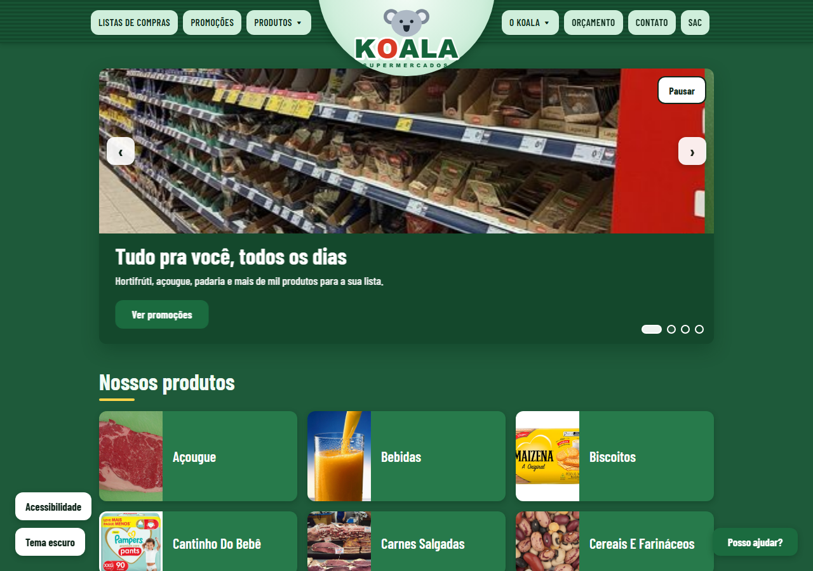

---

## 📚 Sumário

- [Integrantes do grupo](#-integrantes-do-grupo)
- [Introdução — a organização](#-introdução--a-organização)
- [Como iniciar o projeto](#-como-iniciar-o-projeto)
- [Ajustes da última revisão](#-ajustes-da-última-revisão)
- [Prints](#-prints)
- [Estrutura do projeto](#-estrutura-do-projeto)
- [O que cada página faz](#-o-que-cada-página-faz)
- [Acessibilidade](#-acessibilidade)
- [Como publicar na Vercel](#-como-publicar-na-vercel)
- [Desenvolvimento](#-desenvolvimento)
- [Critérios de aceite](#-critérios-de-aceite)
- [Dicas para mexer no projeto](#-dicas-para-mexer-no-projeto)
- [Validação W3C](#-validação-w3c)
- [Domínio](#-domínio)
- [Conclusão](#-conclusão)
- [Fotos e créditos](#-fotos-e-créditos)

---

## 👥 Integrantes do grupo

| Nome | RGM |
|------|----|
| Veronica dos Santos Lima | 48489841 |
| Vitor Arruda Dos Santos | 47351241 |
| Victor Correa | 47093102 |
| Felipe de Oliveira Brito | 47639890 |

---

## 🏪 Introdução — a organização

O **Mercado Koala** é um mercado de bairro localizado na:

> **Rua Dr. Cristiano Altenfelder Silva, 515 — Vila Carrão, São Paulo - SP, CEP 03448-010**

É um negócio familiar, criado para oferecer aos moradores da Vila Carrão produtos frescos, atendimento próximo e preços justos. Tem seções de hortifrúti, açougue, padaria artesanal, mercearia, bebidas, laticínios e produtos de limpeza e higiene.

**Objetivo do site:** divulgar o mercado na internet, com a história da empresa, os departamentos e produtos, as ofertas, uma lista de compras, os canais de contato e os formulários de contato, orçamento e currículo.

---

## 🚀 Como iniciar o projeto

Não precisa instalar nada: não tem `npm`, build nem dependências.

### 1. Baixar o projeto

```bash
git clone https://github.com/veronisky/Koala-mercado-Javascript.git
cd Koala-mercado-Javascript
```

Ou baixe o ZIP em **Code → Download ZIP** no GitHub e extraia.

### 2. Abrir o site

**O jeito mais simples:** dê dois cliques no arquivo `index.html`. Ele abre no navegador.

**O jeito recomendado (servidor local):** com um servidor, o `localStorage` e as fotos funcionam igual ao site publicado. Na pasta do projeto, use uma das opções:

```bash
# Python (já vem instalado na maioria dos computadores)
python -m http.server 8000

# ou Node.js
npx serve .
```

Depois abra **http://localhost:8000** no navegador.

**No VS Code:** instale a extensão **Live Server**, clique com o botão direito em `index.html` e escolha **Open with Live Server**.

### 3. Conferir se está tudo certo

- Aperte `Tab` na página inicial: deve aparecer o link "Pular para o conteúdo".
- Clique em **Acessibilidade** (canto inferior esquerdo) e teste o **Alto contraste**.
- Adicione um produto à lista e recarregue a página: o item deve continuar lá.

---

## 🛠️ Ajustes da última revisão

- **Uma foto para cada produto:** antes, os produtos da mesma categoria usavam a mesma foto (o bife, a picanha, o frango e a linguiça apareciam com a foto do mesmo bife). Agora os **56 produtos** têm foto própria em `img/produtos/`. As 14 fotos das categorias continuam em `img/fotos/`.
- **Acessibilidade:** painel com tamanho da letra e **alto contraste**, link para pular ao conteúdo, foco do teclado em duas cores, botão de pausar o carrossel, erros de formulário ligados aos campos e lista de compras que mantém o foco ao mexer nos itens. A lista completa está em [Acessibilidade](#-acessibilidade).
- **Um site só:** a loja e o site institucional foram unidos, com a página inicial na raiz e as outras 14 páginas em `loja-koala/`. Detalhes em [Desenvolvimento](#-desenvolvimento).
- **Carrossel de destaques** na página inicial: 4 slides com foto real, troca automática a cada 5 s, setas, bolinhas, teclado (← →) e toque no celular. Pausa quando o mouse ou o foco está em cima e respeita `prefers-reduced-motion`.
- **Bordas arredondadas:** o raio passou de 2 px (quase reto) para **12 px** em `css/tokens.css` (`--raio`). Como botões, cards, campos, menu, etiquetas e carrossel usam `var(--raio)`, tudo que era quadrado ficou arredondado de uma vez.
- **Cor mais vendedora:** do azul-céu para **verde escuro** (sugestão recebida). Mudou só em `css/tokens.css` (claro e escuro) e nos SVGs do logo e do app. Os preços continuam em verde, as ofertas em vermelho e o foco do teclado em amarelo.
- **Acabamento:** cards sobem e as fotos dão um leve zoom ao passar o mouse, títulos com traço amarelo, sombras mais suaves, barra de progresso e avisos também arredondados (movimento desligado para quem usa `prefers-reduced-motion`).

---

## 📸 Prints

Capturas reais do site no ar, em computador (1280 px) e no celular (360 px).

### 1. Página inicial
Carrossel de destaques, as 14 categorias com foto e, mais abaixo, as ofertas do dia com cronômetro, as dicas, os horários, o mapa e o cadastro para receber o encarte.


### 2. Produtos de uma categoria
Busca por nome, filtro por categoria, ordenação por nome ou preço e o botão "Adicionar à lista". Cada produto tem a sua própria foto.

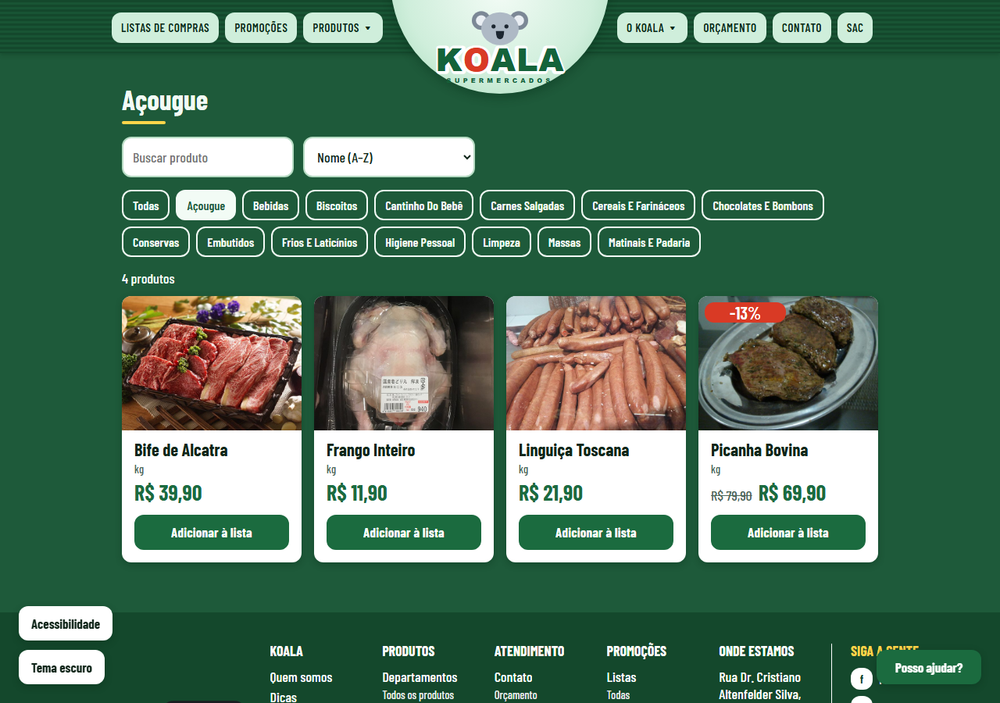

### 3. Lista de compras
Dá para adicionar itens, mudar a quantidade, marcar o que já pegou e ver o total estimado. Tem modelos prontos (Dia-a-Dia, Churrasco e Festa). A lista fica salva no navegador, então não some se a página for recarregada. No print, foi usado o modelo Churrasco.

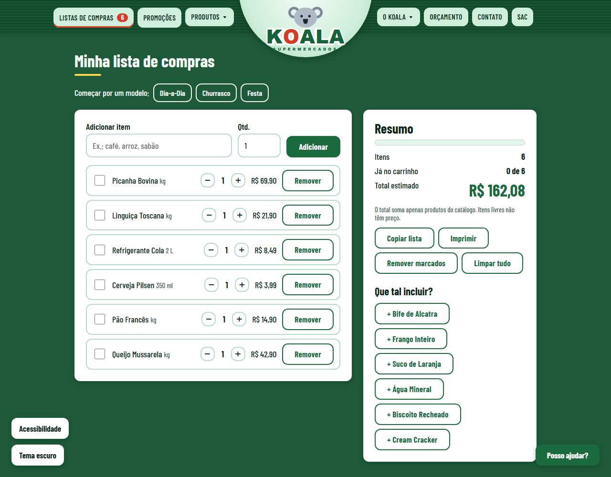

### 4. Promoções
O encarte, com os produtos em oferta ordenados pelo maior desconto.

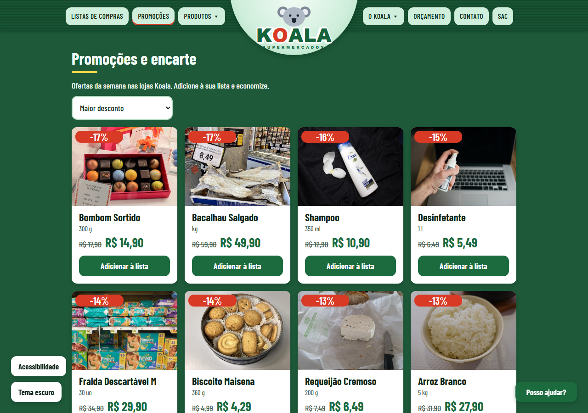

### 5. SAC e canal de denúncias
Duas abas, com validação dos campos e opção de envio anônimo na denúncia.

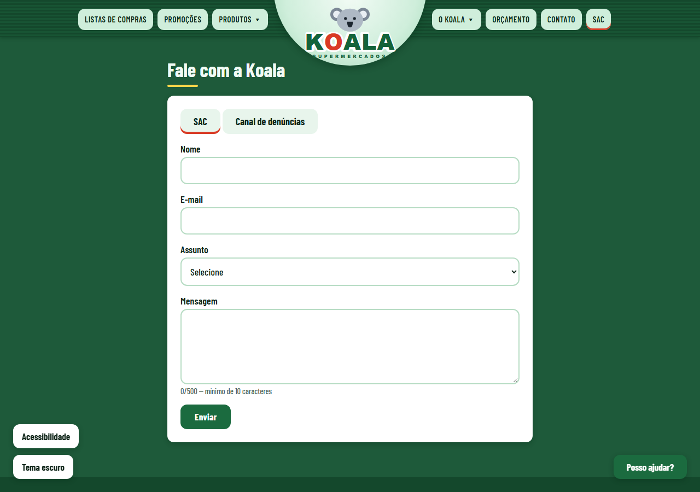

### 6. Contato (validação nativa do HTML5)
Formulário com `required`, `type="email"`, `type="tel"`, `pattern` e máscara de telefone.

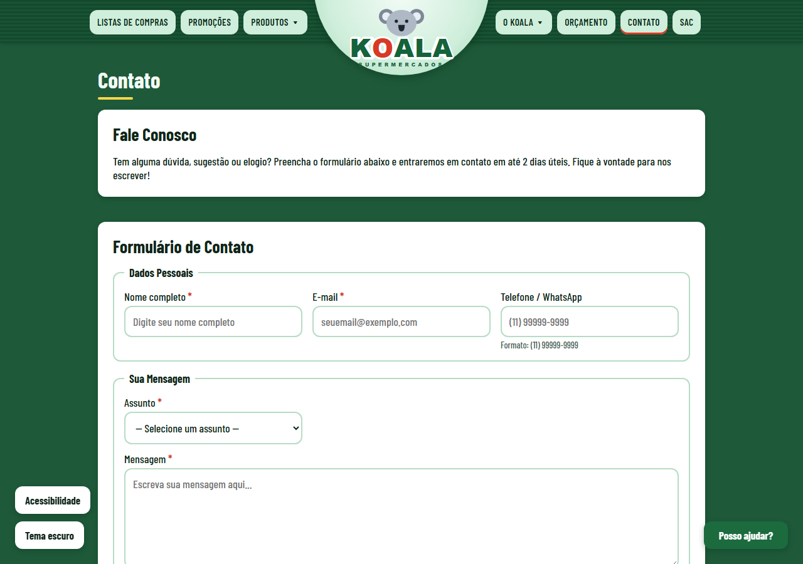

### 7. Departamentos (vídeo e áudio)
Descrição dos departamentos e a seção "Conheça Nosso Mercado", com `<video>` e `<audio>`.

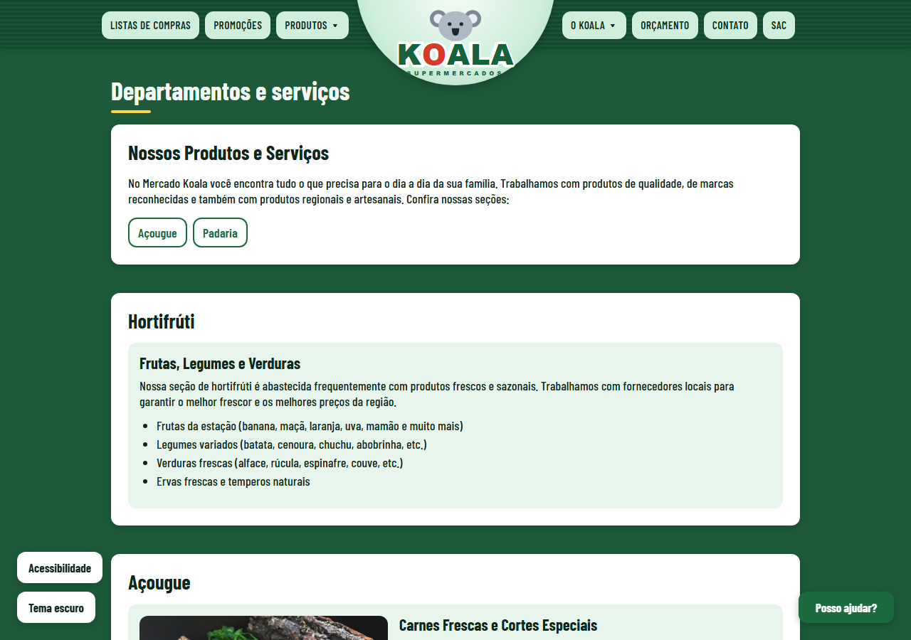

### 8. Catálogo de componentes
Botões, campos, cards e avisos em todos os estados: normal, hover, foco, desabilitado e erro, nos temas claro e escuro.

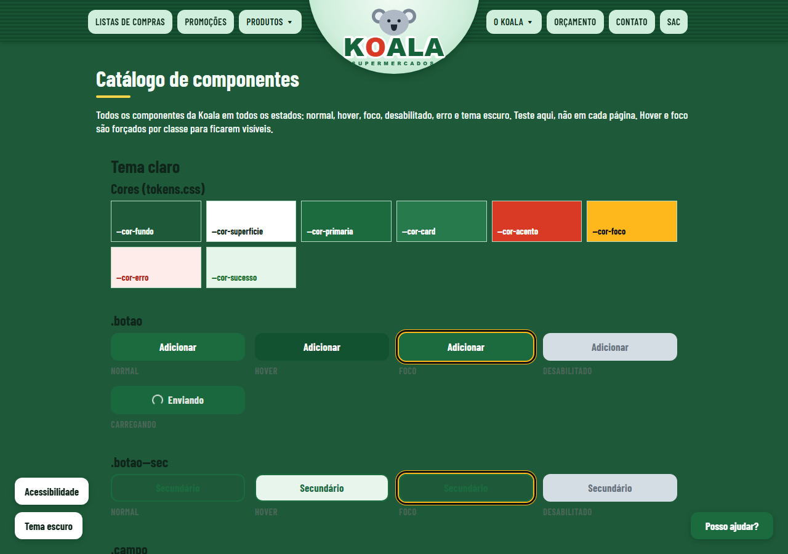

### 9. Tema escuro
O botão "Tema escuro" troca as cores, e o site lembra a escolha.

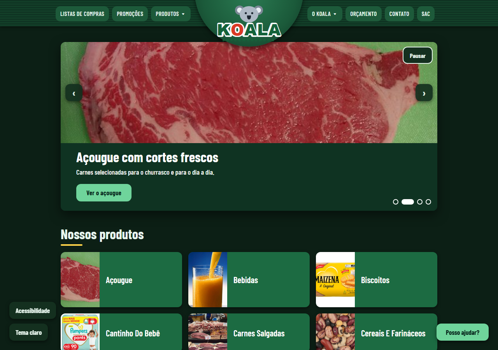

### 10. Painel de acessibilidade
No canto inferior esquerdo: tamanho da letra (A−, A, A+) e alto contraste.

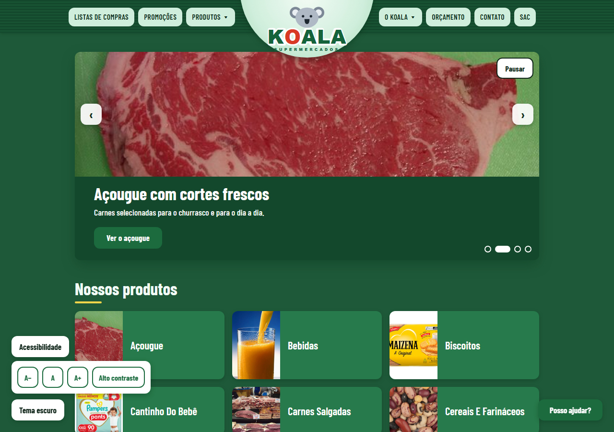

### 11. Alto contraste
Preto, branco e amarelo, com bordas bem marcadas. No print, a letra também está um pouco maior.

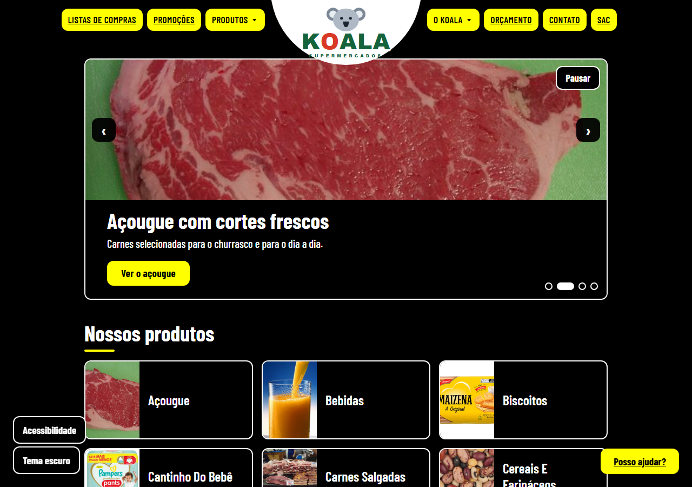

### 12. No celular (360 px)
As categorias viram uma coluna e o menu vira um botão "Menu". À esquerda, a página inicial; à direita, os produtos do açougue.

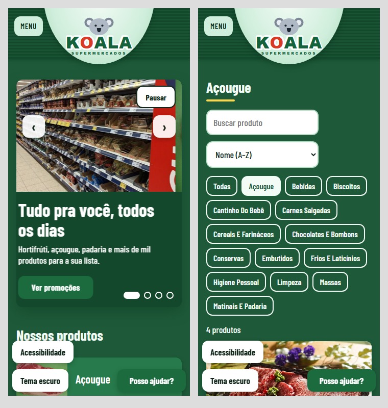

### 13. Rodapé
Aplicativo, mapa do site em colunas, endereço, horário e redes sociais.

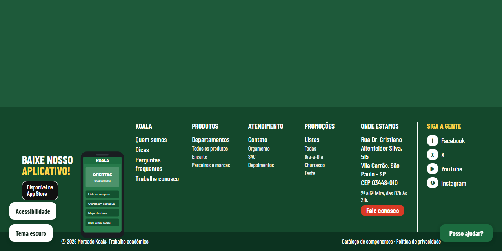

---

## 🗂️ Estrutura do projeto

A página inicial fica na raiz e as outras 14 páginas ficam em `loja-koala/`. Estilos, scripts, imagens, áudio e vídeo ficam em pastas próprias, fora das páginas, e são compartilhados por todo o site.

```
Koala-mercado-Javascript/
├── index.html                  # página inicial
├── README.md                   # este arquivo
├── loja-koala/                 # demais páginas do site
│   ├── produtos.html           # produtos, com busca e filtros
│   ├── promocoes.html          # encarte
│   ├── lista.html              # lista de compras
│   ├── sac.html                # SAC e canal de denúncias
│   ├── catalogo.html           # todos os componentes em todos os estados
│   ├── contato.html            # contato (formulário com validação nativa do HTML5)
│   ├── orcamento.html          # orçamento / solicitação
│   ├── sobre.html              # quem somos (foto da entrevista)
│   ├── departamentos.html      # departamentos e serviços (vídeo e áudio)
│   ├── faq.html                # perguntas frequentes
│   ├── depoimentos.html        # depoimentos de clientes
│   ├── trabalhe-conosco.html   # cadastro de currículo
│   ├── parceiros.html          # parceiros e marcas
│   └── politica.html           # política de privacidade
├── css/
│   ├── tokens.css              # fonte única de cores, espaços, raios e fontes
│   └── estilos.css             # estilo dos componentes e do layout
├── js/
│   ├── data.js                 # categorias, produtos, dicas e modelos de lista
│   ├── app.js                  # tema, acessibilidade, lista e menus do cabeçalho
│   └── formularios.js          # máscaras e confirmação dos formulários
├── img/
│   ├── logo.svg                # logo da Koala
│   ├── app.svg                 # celular do rodapé
│   ├── entrevista-responsavel.jpg, acougue-carnes.jpg, padaria-paes.jpg
│   ├── fotos/                  # fotos das 14 categorias + CREDITOS.md
│   └── produtos/               # uma foto para cada um dos 56 produtos
├── audio/                      # áudio de apresentação
├── video/                      # vídeo de apresentação
├── slide/                      # apresentação do projeto (.pptx)
├── docs/prints/                # imagens usadas neste README
└── .github/workflows/pages.yml # publicação opcional no GitHub Pages (o site principal está na Vercel)
```

São **15 páginas HTML** interligadas pelo mesmo menu (cabeçalho) e pelo mesmo mapa do site (rodapé).

### Como os requisitos técnicos foram atendidos

| Requisito do enunciado | Onde está |
|---|---|
| 10 páginas interligadas, com `index`, `contato` e `orcamento` | 15 páginas; menu igual no `<header>` e mapa do site no `<footer>` de todas |
| `header`, `nav`, `main`, `section`, `article`, `footer` | Em todas as páginas. O cabeçalho e o rodapé estão escritos no HTML (antes eram gerados por JavaScript) |
| Formulário de contato com validação nativa do HTML5 | `loja-koala/contato.html`: `required`, `type="email"`, `type="tel"`, `pattern`, `minlength`, `maxlength`. O navegador bloqueia o envio sem depender de JS |
| Máscaras | `js/formularios.js` formata telefone `(11) 99999-9999` e CNPJ `00.000.000/0000-00` enquanto a pessoa digita. O formato é conferido pelo `pattern` do HTML |
| `<audio>` e `<video>` | `loja-koala/departamentos.html`, seção "Conheça Nosso Mercado" |
| SVG em uma imagem | `img/logo.svg` (logo no cabeçalho) e `img/app.svg` (celular no rodapé) |
| CSS com identidade única, Grid e Flexbox | `css/tokens.css` + `css/estilos.css`. Grid nas grades de categorias, produtos, dicas, rodapé, seções e formulários; Flexbox no corpo, cabeçalho, filtros e botões |
| JavaScript respondendo a eventos | Carrossel, menus, lista de compras, busca e filtros, tema escuro, painel de acessibilidade, abas do SAC, máscaras |
| Validação W3C | Ver [Validação W3C](#-validação-w3c) |

---

## 🛒 O que cada página faz

| Página | O que tem |
|---|---|
| `index.html` | Carrossel de destaques, 14 categorias com foto, ofertas do dia com cronômetro, dicas, horários, mapa e newsletter com validação |
| `loja-koala/produtos.html` | Busca, filtro por categoria, ordenação por nome ou preço e botão para adicionar à lista |
| `loja-koala/promocoes.html` | O encarte, com os produtos em oferta ordenados por desconto |
| `loja-koala/lista.html` | Lista de compras completa (adicionar, quantidade, marcar, total, copiar, imprimir) |
| `loja-koala/sac.html` | SAC e Canal de denúncias (com envio anônimo), em abas, com validação dos campos |
| `loja-koala/catalogo.html` | Todos os componentes em todos os estados |
| `loja-koala/contato.html`, `orcamento.html`, `trabalhe-conosco.html` | Formulários com validação nativa do HTML5 e máscaras |
| `loja-koala/sobre.html`, `departamentos.html`, `faq.html`, `depoimentos.html`, `parceiros.html`, `politica.html` | Páginas institucionais do mercado |

Dois botões ficam sempre no canto da tela: **Acessibilidade** e **Tema escuro**. O site lembra suas escolhas.

---

## ♿ Acessibilidade

A acessibilidade foi pensada com base nas recomendações da **WCAG 2.2 (nível AA)**. O que já está no site:

| Recurso | Como funciona |
|---|---|
| **Painel "Acessibilidade"** | Botão no canto inferior esquerdo. Tem **A−, A e A+** para o tamanho da letra e o botão **Alto contraste**. A escolha fica salva |
| **Alto contraste** | Tema em preto, branco e amarelo, definido no `css/tokens.css`. Liga sozinho se o sistema do usuário pedir mais contraste |
| **Pular para o conteúdo** | Aperte `Tab` assim que a página abrir: aparece o link para ir direto ao conteúdo principal |
| **Foco visível** | Anel de foco em duas cores (escuro por dentro, amarelo por fora), que aparece tanto em fundo claro quanto escuro |
| **Teclado em tudo** | Menu, carrossel, abas do SAC, lista de compras e painel funcionam sem mouse. `Esc` fecha menus e painéis |
| **Carrossel pausável** | Botão "Pausar" e respeito ao `prefers-reduced-motion` (quem prefere menos movimento não vê a troca automática) |
| **Lista de compras** | Ao mexer em um item, o foco do teclado continua no mesmo botão. As ações são anunciadas ("Arroz removido da lista") |
| **Leitor de tela** | Botões com o nome do produto ("Adicionar à lista: Arroz"), preço antigo lido como "De … por …", desconto falado, avisos e erros anunciados |
| **Formulários** | Cada erro aparece junto do campo, ligado a ele com `aria-describedby`, e o foco vai para o primeiro erro |
| **Alvos de toque** | Botões com pelo menos 44 px de altura |

Com a letra no tamanho máximo (150%), o menu de computador pode ficar apertado, mas no celular o menu "hambúrguer" resolve.

Testamos no Chrome (computador). Ainda vale uma conferida com leitor de tela (NVDA ou TalkBack) e com uma ferramenta como o Lighthouse ou o axe.

---

## ☁️ Como publicar na Vercel

O site é estático, então a publicação é simples:

1. Entre em [vercel.com](https://vercel.com) e clique em **Add New → Project**.
2. Importe o repositório `Koala-mercado-Javascript` do GitHub.
3. Em **Root Directory**, deixe a **raiz do repositório** (`./`), porque o `index.html`, o `css/`, o `js/` e o `img/` ficam na raiz.
4. Deixe **Framework Preset** como *Other* e não preencha comando de build.
5. Clique em **Deploy**.

Depois disso, cada `git push` na branch `main` atualiza o site sozinho.

---

## 🛠️ Desenvolvimento

### Entrevista com a organização

O Mercado Koala é o negócio do pai de Marcelo Gabriel Alves, o que garantiu acesso direto ao responsável para levantar informações reais sobre endereço, funcionamento, serviços, produtos e diferenciais do estabelecimento.

A entrevista foi feita de forma presencial.

> 📷 **Foto que comprova o contato com o responsável:** [`img/entrevista-responsavel.jpg`](img/entrevista-responsavel.jpg), também exibida na página [Quem somos](loja-koala/sobre.html).


### Processo de desenvolvimento

**Entrega 1 — estrutura.** As páginas foram escritas primeiro só com HTML semântico, com o conteúdo levantado na entrevista: história, missão, departamentos, horários, formas de pagamento, FAQ e política de privacidade.

**Pesquisa de leiaute.** Usamos como referência o site do Supermercados Guanabara, copiando **só a organização** da página: barra no topo com a logo no centro, grade de categorias com foto, lista de compras e rodapé em colunas. A marca, o logo e as fotos não são do Guanabara.

**Testes de paleta e tipografia.**
1. A primeira versão usava **azul claro com cinza claro** (cores do koala), com Bootstrap só no menu.
2. Na loja nova a cor principal passou para **verde escuro**, que lembra mercado, frescor e confiança. A troca foi feita só em `css/tokens.css`, nos temas claro e escuro, e nos SVGs do logo e do app.
3. Preços ficam em verde, ofertas em vermelho e o foco do teclado em amarelo, para manter o contraste.
4. Tipografia: **Barlow Condensed** (Google Fonts), em escala de 1.25.
5. Geometria: bordas de 12 px (`--raio`) e espaços em escala de 4 px.

**Design system.** Todas as cores, espaços e raios estão em `css/tokens.css`. Nenhum outro arquivo tem cor hexadecimal. A página `loja-koala/catalogo.html` mostra cada componente (botão, campo, card, aviso, item da lista) em todos os estados.

**Reorganização da Entrega 2.** O repositório tinha dois sites: o institucional, na raiz, e a loja, em `loja-koala/`. Eles foram unidos em um só, na estrutura do enunciado:
- a página inicial da loja ficou na raiz; as demais páginas da loja e as institucionais ficaram juntas em `loja-koala/`;
- CSS, JavaScript, imagens, áudio e vídeo ficaram em pastas próprias na raiz (`css/`, `js/`, `img/`, `audio/`, `video/`);
- as páginas institucionais (Quem somos, Departamentos, Contato, Orçamento, FAQ, Depoimentos, Trabalhe conosco, Parceiros, Política) ganharam o visual da loja **sem mudança de conteúdo**. Só saiu uma frase desatualizada que dizia que o vídeo e o áudio seriam "reposicionados quando definirmos o CSS";
- horários, mapa e boas-vindas da antiga página inicial foram para a nova página inicial;
- o cabeçalho, o menu e o rodapé deixaram de ser gerados por JavaScript e passaram a estar no HTML de cada página;
- as perguntas do FAQ viraram `<details>`/`<summary>`, que abrem e fecham sem JavaScript.

**Fotos dos produtos.** Cada produto ganhou uma foto própria, do Wikimedia Commons, para não repetir a imagem da categoria. O `data.js` liga cada foto pelo nome do produto, sem acento e com hífen (`Água Mineral` vira `agua-mineral.jpg`).

**Desafios técnicos.**
- **Caminhos relativos:** as páginas de `loja-koala/` usam `../` para chegar em `css/`, `js/` e `img/`. As fotos dos produtos são montadas pelo JavaScript e precisam funcionar tanto no `index.html` quanto em `loja-koala/`, por isso o `data.js` calcula o endereço a partir da própria localização (`new URL("../img/produtos/", document.currentScript.src)`).
- **Validação nativa x máscara:** a máscara só formata o texto. Quem decide se o campo é válido é o `pattern` do HTML.
- **CNPJ condicional:** o campo só fica obrigatório quando o tipo de cliente é "Pessoa jurídica".
- **Acessibilidade:** link "Pular para o conteúdo", `aria-current` no menu, foco visível em duas cores, tema escuro, alto contraste e ajuste do tamanho da letra.

### Como seria o mesmo resultado feito com IA

O professor passou um fluxo em quatro passos, que é o que usaríamos para obter um resultado equivalente com IA:

1. **Referência antes:** escolher o site de referência (Guanabara) e descrever para a IA só o leiaute que deve ser seguido.
2. **Design system como contexto:** entregar `css/tokens.css` e `AGENTS.md` junto com o pedido, para a IA usar só as variáveis e os componentes existentes.
3. **Prompt com critério de aceite:** pedir cada página com uma lista do que precisa funcionar (exemplo: "o formulário bloqueia o envio sem e-mail válido usando só HTML").
4. **Teste depois:** conferir no navegador em 360, 768 e 1280 px, no `catalogo.html` e no validador W3C.

A IA gera a estrutura bem mais rápido. Mas o conteúdo real (endereço, horários, serviços) só existe porque fizemos a entrevista, e qualquer resposta da IA precisa ser conferida, porque ela inventa dados e caminhos de arquivos com facilidade.

### Uso de IA

- **Claude Code (Anthropic):** usado para reorganizar o repositório na estrutura do enunciado, deixar o cabeçalho e o rodapé fixos no HTML, adaptar as páginas institucionais ao visual da loja, rodar o validador W3C localmente e gerar os prints. Também foi usado para adicionar a acessibilidade (painel, alto contraste, foco, leitor de tela) e buscar as fotos dos produtos no Wikimedia Commons. **Verificação:** todos os links foram conferidos por script, as páginas foram abertas no navegador em 1280 e 360 px, os formulários foram testados (envio bloqueado com campos inválidos, máscaras e confirmação) e as fotos foram conferidas uma a uma, sem repetição.
- **[COMPLETAR pelo grupo]:** quais outras ferramentas e modelos de IA foram usados nas Entregas 1 e 2, para quê, por que e como as respostas foram conferidas.

---

## ✅ Critérios de aceite

- [x] A página inicial mostra as 14 categorias com foto, e cada uma leva ao filtro certo.
- [x] Cada produto tem a sua própria foto, sem repetição.
- [x] Adicionar um produto atualiza o contador da lista sem recarregar a página.
- [x] A lista continua salva depois de recarregar e calcula o total.
- [x] Os formulários mostram o erro de cada campo e levam o foco para o primeiro erro.
- [x] Dá para usar tudo pelo teclado, com foco visível.
- [x] Existe tema escuro e alto contraste, e o site lembra a escolha.
- [x] Não há cor hexadecimal fora do `css/tokens.css`.
- [x] O layout funciona em 360 px e 1280 px.
- [ ] O 768 px ainda precisa de uma conferida.

---

## 💡 Dicas para mexer no projeto

**Trocar uma cor do site inteiro:** abra o `css/tokens.css` e mude a variável (por exemplo, `--cor-primaria`). Como o resto do projeto só usa `var(--cor-...)`, a mudança vale em todas as páginas. Cada tema (claro, escuro e alto contraste) tem o seu bloco no arquivo.

**Criar um tema novo:** acrescente um bloco `[data-tema="nome"]` no `css/tokens.css` com todas as variáveis e depois ligue o atributo `data-tema` no `<html>` pelo `js/app.js`.

**Adicionar ou editar um produto:** os produtos ficam na lista `RAW` do `js/data.js`, no formato `["categoria", "Nome", preço, preço antigo (0 se não tiver), "unidade"]`. O preço antigo maior que zero faz o produto aparecer nas Promoções, com a etiqueta de desconto.

**Trocar a foto de um produto:** coloque a nova foto em `img/produtos/` com o **nome do produto, sem acento e com hífen** (por exemplo, `Água Mineral` vira `agua-mineral.jpg`). O `data.js` liga a foto pelo nome sozinho. Use proporção 4:3 (as atuais têm 640 × 480 px) e acrescente o crédito no `img/fotos/CREDITOS.md`.

**Criar uma categoria nova:** acrescente uma linha em `CATS` no `js/data.js`, com `slug`, nome e foto em `img/fotos/`, e use o mesmo `slug` nos produtos.

**Mudar o tamanho da letra padrão:** o `--fonte-base` do `css/tokens.css` está em `1.125rem`. Todo o texto usa `rem`, então o botão A+ do painel funciona em todas as páginas.

**Antes de commitar:** rode um servidor local, aperte `Tab` pela página inteira para ver se o foco aparece em tudo e teste o alto contraste. Se mexer em cor, confira que não ficou nenhum `#` fora do `css/tokens.css`.

**Testar a acessibilidade:** o Chrome tem o **Lighthouse** em *DevTools → Lighthouse* (marque *Accessibility*). Vale também instalar a extensão **axe DevTools**.

---

## ✅ Validação W3C

Todas as páginas e os arquivos CSS foram verificados com o **Nu Html Checker** (`vnu.jar`, o mesmo motor do https://validator.w3.org/) e passaram **sem erros e sem avisos**:

```
java -jar vnu.jar index.html loja-koala/*.html   # 0 mensagens
java -jar vnu.jar --css css/*.css                # 0 mensagens
```

**[COMPLETAR pelo grupo]:** colocar aqui os prints da validação online, em https://validator.w3.org/ (por endereço do site publicado) e em https://jigsaw.w3.org/css-validator/, que é o que o enunciado pede como comprovação.

---

## 🌐 Domínio

O Mercado Koala ainda não tem domínio próprio. O domínio escolhido é **`mercadokoala.com.br`**: `.com.br` é o padrão para comércio no Brasil e passa mais confiança para clientes locais.

**Pesquisa de disponibilidade:** consulta ao RDAP oficial do Registro.br (`https://rdap.registro.br/domain/mercadokoala.com.br`) em 06/11/2026 retornou **404 (domínio não registrado)**, ou seja, disponível. Para comparar, a mesma consulta para `registro.br`, que existe, retornou 200.
**[COMPLETAR pelo grupo]:** adicionar o print da busca em https://registro.br.

**Como seria a compra:**
1. Pesquisar o nome em https://registro.br.
2. Entrar com conta gov.br ou criar conta no Registro.br, informando o **CNPJ** do mercado (domínio `.com.br` exige CPF ou CNPJ).
3. Escolher o período (1 a 10 anos) e pagar a taxa anual por Pix, boleto ou cartão.
4. Depois da confirmação do pagamento, apontar o DNS para a hospedagem. No GitHub Pages: registros `A` para os IPs do GitHub e o domínio informado em *Settings > Pages > Custom domain*.

---

## 📝 Conclusão

Na Entrega 1, aprendemos que uma boa estrutura HTML, mesmo sem estilo, já organiza o conteúdo e impacta a acessibilidade e o SEO. Na Entrega 2 vimos o valor de ter um design system: com todas as cores em `css/tokens.css`, trocar a paleta de azul para verde, ou criar o tema escuro e o alto contraste, mexeu em um arquivo só.

A maior lição da reorganização final foi não depender de JavaScript para o que é estrutura. O menu e o rodapé gerados por JS deixavam o HTML vazio para o validador, para os buscadores e para quem navega sem JS. Também aprendemos a deixar a validação dos formulários com o próprio HTML5 e usar JavaScript só para melhorar a experiência.

**Limitações conhecidas:**
- os formulários não enviam dados (não há back-end), então o envio é simulado;
- o vídeo e o áudio ainda são provisórios;
- os preços do catálogo são ilustrativos;
- o WhatsApp do mercado ainda não existe;
- o mapa depende de internet.

---

## 📷 Fotos e créditos

As fotos das categorias e dos 56 produtos são do **Wikimedia Commons**, com licenças livres (CC0, domínio público, CC BY e CC BY-SA). O autor e a licença de cada uma estão em [img/fotos/CREDITOS.md](img/fotos/CREDITOS.md). As fotos do açougue e da padaria da página de departamentos estão em `img/`.

---

*Projeto desenvolvido para fins acadêmicos — Desenvolvimento Frontend para Web, 2026.*
